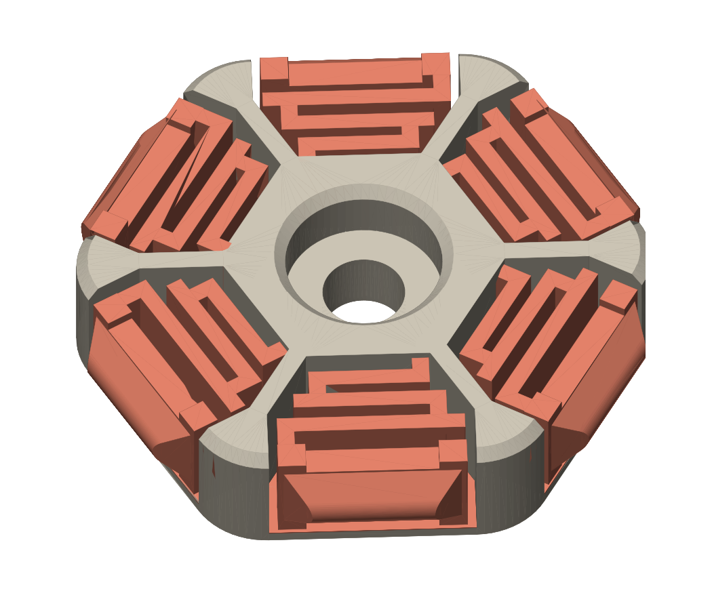
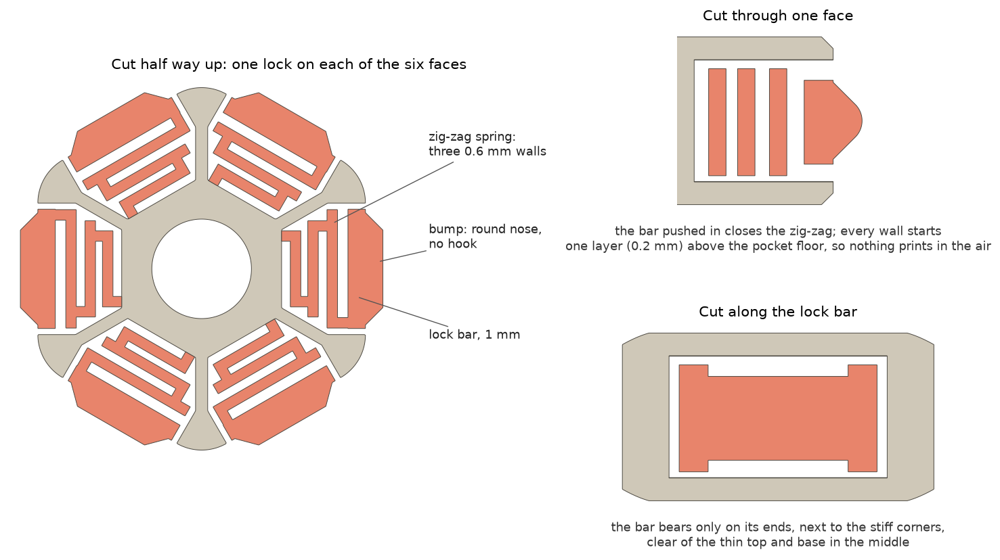

# SnapHex

A hexagonal grid that mounts under the printer's deck, and small snap-fit **mount plugs** that hold the electronics
under it. Screw a plug or two to each board, power supply or bracket and snap it into any cell from below. It comes out
the same way, so any single part can be taken out without touching the rest.

**Configurator: <https://rhapsodyv.github.io/snap-hex/>**

The configurator shows the grid in the printer's frame in 3D and gives you the STLs. With the default values everything
is ready at once. If you change a parameter (frame size, fixing holes, print clearances…), the parts are generated in
your browser. The first change loads the CAD engine, which takes a minute or so, and each grid quadrant takes about half
a minute more.

The first version is made for the **Voron Trident 350** (470 × 470 mm frame, 2020 extrusions).

## The mount plug

Most snap fits either hook in (strong, but they wear out or break when you take them out) or hold very little. The
SnapHex plug holds firmly, and goes in and out many times without marks or fatigue on the plastic. In the tests it held
so tightly that a 6-year-old could hardly pull it out, and its ABS showed no stress whitening.

<p align="center"></p>



- **The lock is a bar along the whole face**, 1 mm thick, with a smooth, round-nosed bump that fits the groove in the
  cell walls. All six faces of the hexagon have one.
- **A zig-zag spring pushes each bar out.** Three 0.6 mm segments, one pass of a 0.4 mm nozzle each, are joined at
  alternating ends. Near the end of the travel the segments rest on each other, so the spring stiffens just where it has
  to hold. It bends at most about 2.2 %, less than the original two-leaf design.
- **The spring alone holds the plug.** The bump has no hook and no flat ledge: going in and coming out follow the same
  path, and the force goes into the spring instead of into the plastic.
- **The bar rests on its ends.** The spring gives the bar almost no vertical support, so the vertical load goes through
  the bar's ends into the stiff corners of the plug. Without that, the bar pushed the plug's thin top and base out of
  shape.
- **Nothing is printed in the air.** Every spring part starts one layer (0.2 mm) above the floor of its pocket, and the
  plug prints base down with no supports.

By a beam model, one plug takes about 2 to 4 kg of straight pull to come out. For a weight that hangs on it all the time,
count on a fraction of that, and use two or more plugs per part. The grid is printed in ABS, like the plugs.

The pictures come from `generator/figures.py`. `generator/spring_model.py` is the beam model used to tune it: spring force and strain for each variant, and the pull
along the way out. The design notes, in Portuguese, are in [`generator/README.md`](generator/README.md), with every
variant that was printed and tested.

## Parts (Trident 350)

| Part | Qty | |
|---|---|---|
| `quadrant_BL`, `quadrant_BR`, `quadrant_FL`, `quadrant_FR` | 1 each | the grid, in four pieces that fit a 350 bed (about 235 × 241 mm) |
| `spline` | 39 | flat splines that join the quadrants along the seams |
| `mount_plug` | as many as you need | the snap-fit plugs, with an M3 screw hole |

Print everything base down, as the files come, with no supports. Print the grid and the plugs with the same slicer
profile: the snap fit lives in the cells' groove. The grid is held by M5 screws through its edge into the bottom
extrusions' inner T-slot, and by four standoffs that screw to the deck panel.

## Repository

| Folder | What is in it |
|---|---|
| [`generator/`](generator) | The generator, in Python with [build123d](https://github.com/gumyr/build123d): every dimension in `params.py`, the grid, the plugs, the spring model and the design notes. |
| [`web/`](web) | The configurator: a static site that runs the same generator in the browser, on [Pyodide](https://pyodide.org) and [OCP.wasm](https://github.com/yeicor/OCP.wasm). |

## Running it locally

```bash
python3 -m venv .venv && .venv/bin/pip install build123d==0.13.0 matplotlib scipy
```

```bash
.venv/bin/python generator/build.py
```

That builds every part into `out/` (STEP, STL, BREP and previews; about a minute, quadrants in parallel). The configurator
runs from `web/`; see [`web/README.md`](web/README.md). Pushes to `main` publish it on GitHub Pages
(`.github/workflows/pages.yml`), which also builds the ready-made default parts.

## License

You may use, change, share and sell it, as long as you credit the original work (SnapHex, by
Victor Oliveira, [rhapsodyv](https://github.com/rhapsodyv), with a link to this repository):

- the code (the generator and the configurator) under the [MIT License](LICENSE);
- the designs and the parts made from them (STL, STEP, drawings) under
  [Creative Commons Attribution 4.0](LICENSE-designs.md) (CC BY 4.0).
